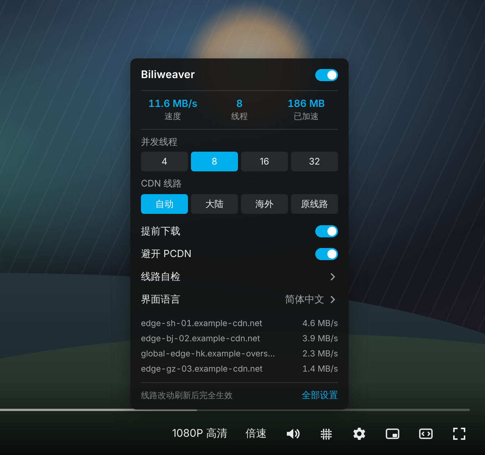
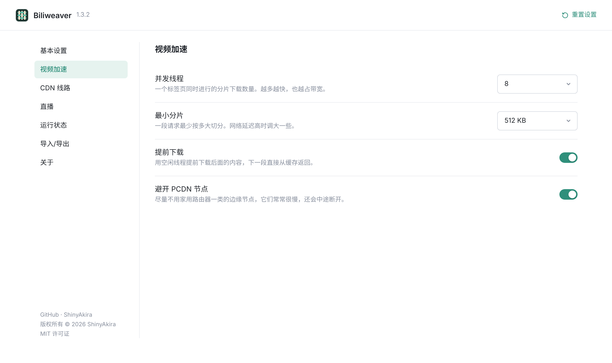
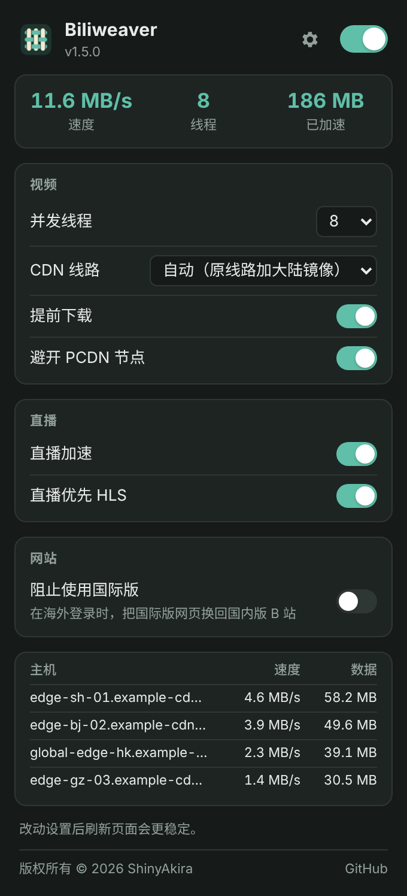
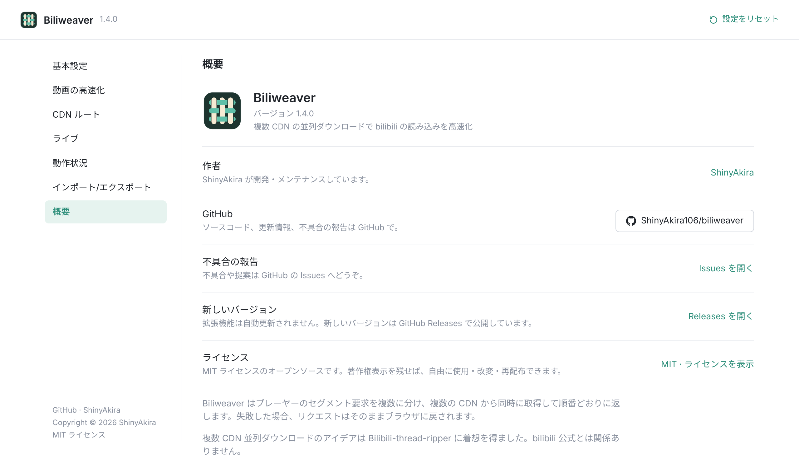
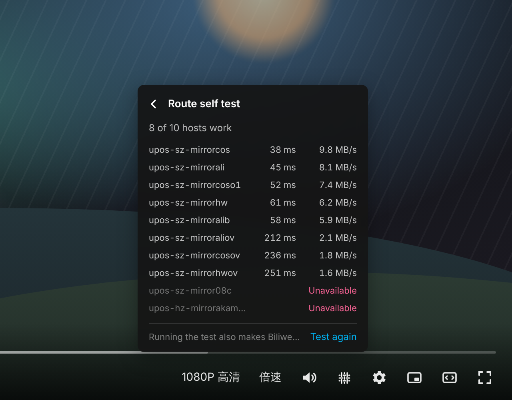
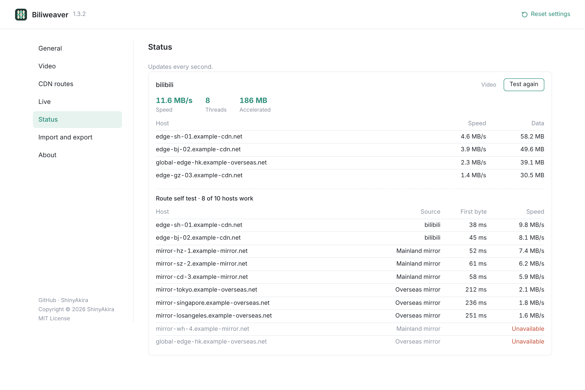
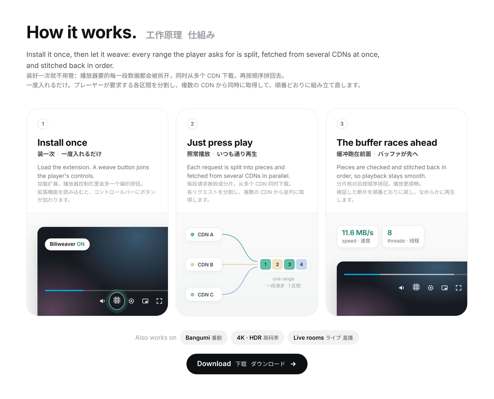

<p align="center"></p>

# Biliweaver

<p align="center">
  <a href="LICENSE"></a>
  
  
  <a href="https://github.com/ShinyAkira106"></a>
</p>

简体中文 · English · 日本語（界面支持三种语言 / interface in three languages / 3 言語に対応）

一个 Chrome 扩展：把哔哩哔哩播放器的视频分段请求拆成多路，同时从多个 CDN 下载，再按顺序交回给播放器，让缓冲更快。直播间也会优选线路，并提前下载 HLS 分片。B 站自己的播放器、弹幕、画质切换都照常使用。

A Chrome extension that splits the bilibili player's video segment requests into several parallel downloads from multiple CDN hosts, then hands the bytes back to the player in order, so buffering is faster. In live rooms it also orders the CDN hosts by speed and prefetches HLS segments. bilibili's own player, danmaku and quality switching keep working as usual.

<p align="center">
  
</p>
播放器控制栏里的 Biliweaver 面板。

The Biliweaver panel in the player's control bar.

## 安装 / Install

从 [Releases](https://github.com/ShinyAkira106/biliweaver/releases) 下载 `biliweaver-v版本号.zip` 并解压到一个固定的文件夹。打开 `chrome://extensions`（Edge 是 `edge://extensions`），打开右上角的“开发者模式”，点“加载已解压的扩展程序”，选择解压出来、里面有 `manifest.json` 的文件夹。需要 Chrome 116 或更新的版本。

Download `biliweaver-v<version>.zip` from [Releases](https://github.com/ShinyAkira106/biliweaver/releases) and unzip it into a folder you will keep. Open `chrome://extensions` (or `edge://extensions`), switch on Developer mode, choose "Load unpacked", and pick the unzipped folder that contains `manifest.json`. Chrome 116 or newer is required.

播放器右下角的控制栏里，设置按钮旁边会多一个 Biliweaver 按钮。点开是一个和播放器风格一致的小面板：总开关、实时速度、并发线程、CDN 线路、提前下载、避开 PCDN，以及正在使用的线路和速度。全屏时也能打开。点“全部设置”或工具栏上的 Biliweaver 图标，可以看到完整的设置。图标上的数字是当前标签页正在运行的下载线程数。不想要播放器里的按钮，可以在完整设置里关掉。按钮会自动对齐旁边原生按钮的尺寸、间距和颜色。

完整设置页左边是分组导航（基本设置、视频加速、CDN 线路、直播、运行状态、导入/导出、关于），右边每一项都有标题和一句说明。界面支持简体中文、English 和日本語，默认跟随浏览器，也可以在“基本设置”里切换。

A Biliweaver button sits in the player's bottom right control bar, next to the settings button. It opens a small panel styled like the player's own menus: the main switch, live speed, threads, CDN route, prefetch, PCDN avoidance, and the hosts in use with their speeds. It works in fullscreen too. "全部设置" (all settings) or the Biliweaver toolbar icon opens the full settings. The number on the icon is how many download threads the current tab is running. The in-player button can be switched off in the full settings. It matches the size, spacing and color of the native button next to it automatically.

The full settings page has section navigation on the left (General, Video, CDN routes, Live, Status, Import and export, About), and every setting on the right comes with a title and a one line explanation. The interface is available in Simplified Chinese, English and Japanese; it follows the browser by default and can be switched under General.

## 界面一览 / Screenshots / スクリーンショット

<p align="center">
  
</p>

控制栏里的 Biliweaver 按钮，尺寸和间距会自动对齐旁边的原生按钮。

The Biliweaver button in the control bar, matched in size and spacing to the native buttons next to it.

<p align="center">
  
</p>

完整设置页：左侧是分组导航，右侧每一项都有标题和一句说明。

The full settings page: section navigation on the left, and a title with a one line explanation for every setting on the right.

<p align="center">
  
</p>

工具栏弹窗：常用设置和当前页面的实时数据。

The toolbar popup: the most used settings and live stats for the current page.

<p align="center">
  
</p>

界面支持简体中文、English 和日本語，图为日文的“关于”页。

The interface comes in Simplified Chinese, English and Japanese; this is the About page in Japanese.

## 线路自检和诊断信息 / Route self test and diagnostics

播放器面板里的“线路自检”和设置页“运行状态”里的按钮，会向当前视频的每条候选线路请求一小段数据，列出哪些能用、首字节延迟和速度，结果也会马上用来调整线路优先级。设置页“导入/导出”里的“导出诊断信息”可以复制或下载一份报告，包含版本、浏览器、设置、线路状态、最近的错误和上次自检结果，不包含页面标题和视频地址。提交 [Issues](https://github.com/ShinyAkira106/biliweaver/issues/new) 时附上它，能更快找到问题。

"Route self test", in the player panel and on the Status page of the settings, asks every candidate host for a small piece of the current video and lists which work, with first byte latency and speed; the results immediately feed the host ranking too. "Export diagnostics" under Import and export copies or downloads a report with the version, browser, settings, host status, recent errors and the last self test, leaving out page titles and video addresses. Attaching it to an [issue](https://github.com/ShinyAkira106/biliweaver/issues/new) makes problems much faster to track down.

プレーヤーパネルと設定画面の「動作状況」にある「ルートの自己診断」は、現在の動画の候補ホストすべてに小さなデータを要求し、利用できるか、初回応答の遅延と速度を一覧表示します。結果はすぐにホストの優先度にも反映されます。「インポート/エクスポート」の「診断情報をエクスポート」では、バージョン、ブラウザ、設定、ホストの状態、最近のエラー、前回の診断結果をコピーまたはダウンロードできます。ページタイトルや動画アドレスは含みません。[Issues](https://github.com/ShinyAkira106/biliweaver/issues/new) に添付していただくと原因を特定しやすくなります。

<p align="center">
  
</p>

播放器面板里的线路自检。

The route self test in the player panel.

<p align="center">
  
</p>

设置页“运行状态”里的线路自检。截图中的线路和速度为示例数据。

The route self test on the settings Status page. Hosts and speeds in these screenshots are example data.

## 自动保护、省流量和新版本提醒 / Protection, data saving and update notices / 自動保護・通信量の節約・更新のお知らせ

### 自动保护 / Automatic protection / 自動保護

同一个页面短时间内连续出错时，Biliweaver 会暂停加速 5 分钟，让请求按原来的方式发出，面板里会显示原因，也可以点“立即恢复”。CDN 返回限流（429，或者之前正常的主机突然返回 403）时，会把线程数减半，之后每分钟恢复一档。直播间用 HLS 放不出来时，会记住这个直播间，一天内改用 FLV。

After repeated errors on a page, Biliweaver steps aside for 5 minutes so requests go out unchanged; the panel says why and offers "Resume now". When a CDN rate limits (429, or a 403 from a host that was fine before), it halves the threads and restores them a step a minute. If HLS fails to play in a live room, that room uses FLV for a day.

同じページでエラーが続くと、Biliweaver は 5 分間高速化を止め、リクエストを元の方法で送ります。理由はパネルに表示され、「今すぐ再開」もできます。CDN が制限をかけたとき（429、またはそれまで正常だったホストからの 403）はスレッド数を半分にし、1 分ごとに 1 段階ずつ戻します。ライブ配信で HLS が再生できない場合は、その配信を 1 日 FLV で再生します。

### 省流量和省内存 / Saving data and memory / 通信量とメモリの節約

视频暂停时、浏览器开启省流量模式时，会停止提前下载；缓存上限也会按电脑内存大小自动调整。

Prefetch stops while the video is paused or the browser's data saver is on, and the cache limit follows the computer's memory.

一時停止中やデータセーバーが有効なときは先読みを止め、キャッシュの上限はパソコンのメモリに合わせて調整します。

### 新版本提醒 / Update notices / 更新のお知らせ

扩展不会自动更新，所以每次打开完整设置页时，会检查 GitHub 上有没有新版本，有的话在页面顶部显示下载链接。

The extension doesn't update itself, so each time the full settings page opens it checks GitHub for a newer version and shows a download link at the top.

自動更新はされないため、設定画面を開くたびに GitHub で新しいバージョンを確認し、あれば画面上部にダウンロードリンクを表示します。

## 工作原理 / How it works

<p align="center">
  <a href="https://github.com/ShinyAkira106/biliweaver/releases"></a>
</p>

普通视频和番剧：播放器从 B 站的播放地址接口拿到每一路视频和音频的主地址和备用地址，再按字节范围（HTTP Range）一段一段地下载。Biliweaver 在页面里包装了 `fetch` 和 `XMLHttpRequest`。播放器要一段数据时，这一段会被切成几个更小的分片，同时发给当前最快的几个 CDN 主机：播放地址接口给出的主机，加上设置里选择的镜像主机。每个分片都会核对服务器返回的 `Content-Range` 和文件总大小，对不上的主机会被暂停使用。某个分片明显比预期慢时，会在另一台主机上再下载一份，谁先完成用谁。播放器的下一段请求通常紧接着上一段，所以 Biliweaver 会用空闲的线程提前下载后面的内容，下一次请求就直接从缓存返回。任何一步出错，请求都会原样交回给浏览器，最差也只是回到不加速的状态。

Videos and bangumi: the player gets the main and backup addresses of every video and audio stream from bilibili's play address API, then downloads them piece by piece with HTTP Range requests. Biliweaver wraps `fetch` and `XMLHttpRequest` inside the page. When the player asks for a range, that range is cut into smaller pieces and sent at the same time to whichever CDN hosts are fastest right now: the hosts the play address API listed, plus the mirror hosts chosen in the settings. Every piece is checked against the `Content-Range` the server returns and against the file size, and a host that disagrees is taken out of use. When one piece is much slower than expected, a second copy is started on another host and whichever finishes first wins. The player's next request usually follows straight after the previous one, so Biliweaver uses idle threads to download ahead, and that next request is answered from the cache. If anything goes wrong, the request is handed back to the browser untouched, so the worst case is ordinary, unaccelerated playback.

直播：直播流不能像点播那样按字节拆分。Biliweaver 会按本页测到的速度给直播间的 CDN 主机排序；打开“优先使用 HLS”时，如果直播间同时提供 FLV 和 HLS，会让播放器使用 HLS（fMP4 优先）。播放器每次刷新 HLS 播放列表，列表里最新的几个分片会立刻并行开始下载，播放器自己请求这些分片时直接拿到已经下载好的数据。

Live: a live stream cannot be split by byte range like a stored video. Biliweaver orders the room's CDN hosts by the speed measured on the page; with "Prefer HLS" on, when a room offers both FLV and HLS, the player is steered to HLS (fMP4 first). Each time the player reloads the HLS playlist, the newest segments it lists start downloading in parallel right away, and when the player requests them it receives the data that is already there.

## 设置 / Settings

“并发线程”是整个标签页同时进行的分片下载数量，默认 8。“最小分片”决定一段请求最多被切成几份。“CDN 线路”可以选择自动（B 站给的线路加大陆镜像）、只用大陆镜像、海外镜像、只用 B 站给的线路，或者自定义主机列表。“避开 PCDN 节点”会尽量不用家用路由器一类的边缘节点，它们常常很慢，还会在下载中途消失。直播部分可以单独关闭。

"Threads" is the number of piece downloads a tab runs at once, 8 by default. "Minimum piece size" decides how many pieces one request can be split into. "CDN route" can be automatic (bilibili's hosts plus the mainland mirrors), mainland mirrors only, overseas mirrors, bilibili's hosts only, or a custom host list. "Avoid PCDN nodes" keeps away from home router style edge nodes, which are often slow and can disappear mid download. Live acceleration can be switched off on its own.

镜像主机列表在 `shared/settings.js` 里。不响应的主机会被自动暂停，所以列表里有过期的主机，代价也只是一次失败的请求。

The mirror host list is in `shared/settings.js`. Hosts that do not answer are paused automatically, so a stale entry only costs one failed request.

## 开发 / Development

项目没有任何依赖。`node scripts/build.mjs` 生成 `dist/biliweaver/`（可以直接加载）和 `dist/biliweaver-v版本号.zip`。`node tests/engine-test.mjs` 在 Node 里用模拟的 CDN 测试下载引擎；`node tests/extension-test.js dist/biliweaver` 用 Playwright 把扩展加载进 Chromium，用模拟的 B 站页面和 CDN 做端到端测试。 README 里的截图由 `node scripts/screenshots.js`、`node scripts/hover-gif.js` 和 `node scripts/how-it-works.js` 生成，背景是示意播放器，数值是示例。

There are no dependencies. `node scripts/build.mjs` produces `dist/biliweaver/` (ready to load) and `dist/biliweaver-v<version>.zip`. `node tests/engine-test.mjs` tests the download engine in Node against a simulated CDN; `node tests/extension-test.js dist/biliweaver` loads the extension into Chromium with Playwright and runs end to end tests against simulated bilibili pages and CDN hosts. The README images come from `node scripts/screenshots.js`, `node scripts/hover-gif.js` and `node scripts/how-it-works.js`; the player is a drawn mock and the numbers are examples.

```text
manifest.json        扩展清单 / extension manifest
background.js        徽标和统计 / badge and stats (service worker)
shared/settings.js   默认设置、校验、镜像列表 / defaults, validation, mirror list
shared/i18n.js       界面文字（中、英、日） / interface text (zh, en, ja)
_locales/            扩展名称和简介的翻译 / translated extension name and description
options/             完整设置页 / full settings page
page/core.js         设置、主机评分、线程池、统计 / settings, host scoring, slots, stats
page/transfer.js     并行分片下载和缓存 / parallel range downloader and cache
page/intercept.js    包装 fetch 和 XHR / fetch and XHR wrapping
page/vod.js          点播 / videos and bangumi
page/live.js         直播 / live rooms
page/selftest.js     线路自检 / route self test
content/relay.js     页面和扩展之间的桥 / bridge between page and extension
content/player-button.js  播放器控制栏里的按钮和面板 / control bar button and panel
popup/               工具栏弹窗 / toolbar popup
docs/images/          README 截图和示意图 / README screenshots and diagram
```

页面里的代码运行在页面自己的环境（`world: MAIN`）中，不能使用 `chrome.*`；`content/relay.js` 运行在扩展的隔离环境里，负责读写设置和转发统计，两边通过带 JSON 文本的 DOM 事件通信。Chrome 在同一个框架里只注入同一个脚本文件一次，所以构建时会给每个环境打一个单独的包。

The page code runs in the page's own world (`world: MAIN`) and cannot use `chrome.*`; `content/relay.js` runs in the extension's isolated world, reads and writes the settings and forwards stats, and the two talk through DOM events carrying JSON text. Chrome injects a given script file only once per frame, so the build makes a separate bundle for each world.

开启调试日志：在 B 站页面的控制台运行 `localStorage.setItem("biliweaver:debug", "1")` 后刷新。

Debug logging: run `localStorage.setItem("biliweaver:debug", "1")` in the console of a bilibili page and reload.

## 致谢 / Acknowledgements

多 CDN 并发下载的思路受到 [Bilibili-thread-ripper](https://github.com/MrTangLuyao/Bilibili-thread-ripper) 的启发。Biliweaver 是独立编写的代码，没有使用该项目的源码。

The idea of parallel multi-CDN downloading was inspired by [Bilibili-thread-ripper](https://github.com/MrTangLuyao/Bilibili-thread-ripper). Biliweaver is independently written and contains none of that project's source code.

## 作者 / Author / 作者

Biliweaver 由 [ShinyAkira](https://github.com/ShinyAkira106) 开发和维护。欢迎在 [Issues](https://github.com/ShinyAkira106/biliweaver/issues/new) 里提出问题和建议。

Biliweaver is made and maintained by [ShinyAkira](https://github.com/ShinyAkira106). Issues and suggestions are welcome in [Issues](https://github.com/ShinyAkira106/biliweaver/issues/new).

Biliweaver は [ShinyAkira](https://github.com/ShinyAkira106) が開発・メンテナンスしています。不具合の報告や提案は [Issues](https://github.com/ShinyAkira106/biliweaver/issues/new) へどうぞ。

## 许可 / License / ライセンス

版权所有 © 2026 ShinyAkira。基于 [MIT 许可证](LICENSE) 开源。本项目与哔哩哔哩官方无关。

Copyright © 2026 ShinyAkira. Released under the [MIT License](LICENSE). This project is not affiliated with bilibili.

Copyright © 2026 ShinyAkira。[MIT ライセンス](LICENSE)のもとで公開しています。本プロジェクトは bilibili 公式とは関係ありません。
